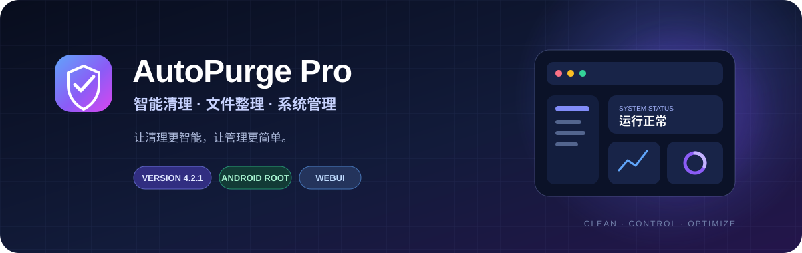
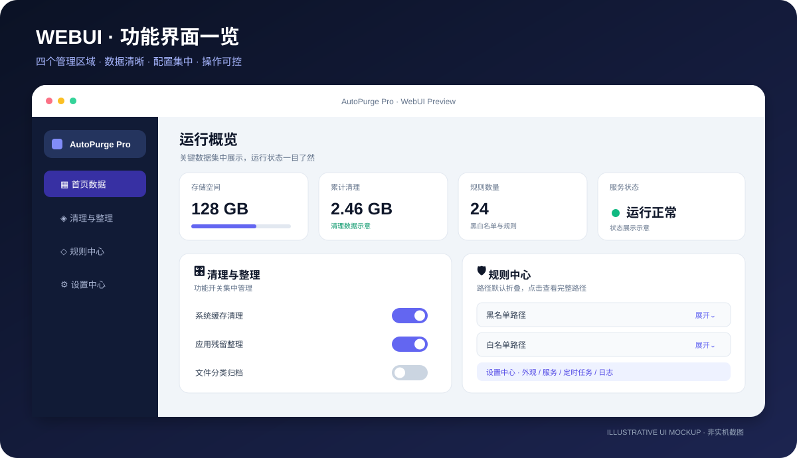
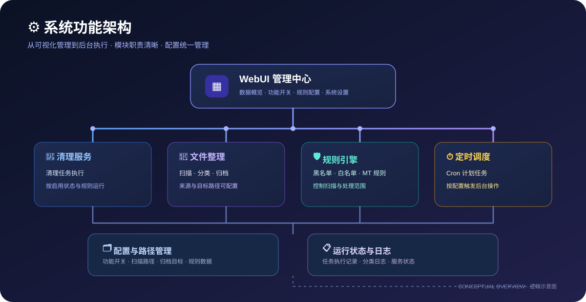

<!-- AutoPurge Pro README -->

  

  # 🧹 AutoPurge Pro

  ### 智能清理 · 文件整理 · 系统维护

  **让清理更智能，让管理更简单。**

  面向 Android Root 用户的可视化清理与文件管理模块

  

    
    
    
    
    
  

  

    <a href="https://github.com/yunyu614/AutoPurge-Pro/releases/latest">⬇️ 下载最新版</a>
    &nbsp;·&nbsp;
    <a href="https://github.com/yunyu614/AutoPurge-Pro/releases">📦 历史版本</a>
    &nbsp;·&nbsp;
    <a href="https://github.com/yunyu614/AutoPurge-Pro/issues">💬 问题反馈</a>
  

---

## 📖 目录

- [项目简介](#-项目简介)
- [核心功能](#-核心功能)
- [WebUI 页面](#-webui-页面)
- [运行环境](#-运行环境)
- [安装与升级](#-安装与升级)
- [稳定性与安全说明](#-稳定性与安全说明)
- [更新记录](#-更新记录)
- [问题反馈](#-问题反馈)
- [版权声明](#-版权声明)

---

## 📌 项目简介

**AutoPurge Pro** 是一款运行于 Android Root 环境的清理与文件管理模块。

项目采用 **Shell 后台任务 + WebUI 可视化管理** 的方式，将日常清理、文件扫描与归档、规则配置、定时任务、运行日志和数据统计整合到统一入口。

它希望解决的不只是“清理文件”，还包括日常维护中配置分散、路径难管理、执行状态不直观等问题：

- 📊 重要运行数据集中展示
- 🎛️ 功能开关与常用操作统一管理
- 🛡️ 通过规则与路径配置控制处理范围
- 📁 按照配置扫描、整理和归档文件
- 📋 在日志中心查看各功能运行记录

### ✨ 设计原则

| 原则 | 说明 |
|:---|:---|
| 🧭 清晰易用 | 页面按用途分区，减少重复说明和冗余信息 |
| 🎨 视觉统一 | 采用轻科技风格，统一卡片、按钮、图标和状态反馈 |
| ⚙️ 灵活配置 | 支持按需调整功能开关、规则和文件路径 |
| 🛡️ 操作可控 | 通过黑名单、白名单及规则配置约束处理范围 |
| 🚦 稳定优先 | 长耗时文件任务采用后台执行思路，避免让界面一直等待 |

---

## 🚀 核心功能

<table>
  <tr>
    <td width="50%">
      <h3>🧹 智能清理</h3>
      集中管理清理项目，按需启用功能并执行清理任务。
    </td>
    <td width="50%">
      <h3>📁 文件扫描与整理</h3>
      扫描指定位置，根据规则将文件分类并归档到目标目录。
    </td>
  </tr>
  <tr>
    <td>
      <h3>🛡️ 黑名单 / 白名单</h3>
      配置排除或保护范围，减少不希望被处理的目录。
    </td>
    <td>
      <h3>🧩 MT 规则</h3>
      集中管理文件整理相关规则，按实际配置执行。
    </td>
  </tr>
  <tr>
    <td>
      <h3>⏱️ 定时任务</h3>
      支持通过 Cron 调度自动化任务，具体执行情况以设备环境为准。
    </td>
    <td>
      <h3>📊 数据统计</h3>
      首页集中查看存储信息、清理统计、规则数量和服务状态。
    </td>
  </tr>
  <tr>
    <td>
      <h3>📋 分类日志</h3>
      在日志中心按功能查看运行记录，便于了解任务执行情况。
    </td>
    <td>
      <h3>🎛️ 可视化 WebUI</h3>
      通过统一界面管理功能开关、路径、规则和服务配置。
    </td>
  </tr>
</table>

---

## 🖥️ WebUI 页面

  

说明：此处为项目展示用的界面概念示意图，不代表当前版本的真实设备截图；实际显示以安装后的 WebUI 为准。

| 页面 | 功能定位 | 主要内容 |
|:---|:---|:---|
| **01 · 📊 首页** | 数据总览 | 存储信息、清理统计、规则数量、服务状态 |
| **02 · 🎛️ 清理与整理** | 日常操作 | 清理功能开关、文件整理开关、扫描与整理操作 |
| **03 · 🛡️ 规则中心** | 范围控制 | 黑名单、白名单、MT 规则、扫描来源与归档目标 |
| **04 · ⚙️ 设置中心** | 全局配置 | 外观、服务配置、定时任务、功能说明与分类日志 |

### UI 设计重点

- **首页以数据为主：** 重要状态和统计信息优先展示。
- **操作入口集中：** 清理与文件整理功能不再分散在多个页面。
- **路径默认折叠：** 长路径默认收起，展开后查看或编辑，避免占用过多屏幕空间。
- **日志集中管理：** 首页不堆叠详细日志，统一从设置中心进入日志页面。
- **轻科技视觉：** 蓝紫主题、柔和卡片层次、统一圆角与状态颜色。

---

## 🧩 系统功能架构

  

架构图用于说明功能模块之间的逻辑关系，不代表所有内部实现细节。

---

## 📱 运行环境

| 项目 | 说明 |
|:---|:---|
| **系统平台** | Android |
| **运行权限** | Root |
| **优先适配方向** | KernelSU |
| **脚本环境** | Shell / BusyBox |
| **管理方式** | WebUI |
| **其他环境** | 以发布包说明及设备实际表现为准 |

> ⚠️ 不同 Android 版本、设备厂商系统、Root 管理器及 BusyBox 实现可能存在兼容性差异。请以实际设备测试结果为准。

---

## 📥 安装与升级

### 🆕 全新安装

1. 打开 [GitHub Releases](https://github.com/yunyu614/AutoPurge-Pro/releases)。
2. 下载对应版本的 AutoPurge Pro ZIP 安装包。
3. 打开 KernelSU 或兼容的 Root 模块管理器。
4. 进入模块管理页面，选择本地安装。
5. 选择下载的 ZIP 文件，按照管理器提示完成安装。
6. 根据提示重新加载模块或重启设备。
7. 打开模块 WebUI，检查首页状态及各功能配置。

### 🔄 更新升级

1. 前往 [Releases](https://github.com/yunyu614/AutoPurge-Pro/releases) 下载目标版本。
2. **升级前建议备份现有配置及重要数据。**
3. 使用 Root 模块管理器安装新版本。
4. 按照提示完成重载或重启。
5. 更新后检查功能开关、黑白名单、规则和路径配置是否符合预期。

> 📝 不同 Root 管理器的安装入口和模块重载方式可能略有区别，请以管理器界面提示为准。

---

## 🛡️ 稳定性与安全说明

AutoPurge Pro 涉及 Root 权限及文件操作。为了降低误操作和长任务对界面的影响，项目持续优化任务执行与界面交互：

- 长耗时文件扫描和归档采用后台任务执行方式，并通过状态查询反馈进度或结果。
- 对重复触发的文件任务增加保护，避免同一操作被连续启动。
- WebUI 对部分状态请求进行合并，减少重复请求。
- 视觉升级以 CSS 样式为主，不依赖大型动画框架。
- 页面动效以轻量反馈为主，并支持减少动态效果的系统偏好。

**重要提示：** 上述设计用于降低卡顿风险，并不代表所有设备和 Root 环境下都能保证绝对不卡顿或不会发生异常。真实表现仍受设备性能、系统版本、Root 管理器、文件数量和存储状态影响。

执行清理或文件整理前，请确认扫描范围、目标路径及规则；不要在未确认内容时对重要目录执行批量操作。建议先备份重要文件，并优先使用少量文件进行测试。

---

## 🆕 更新记录

### 

**Light Tech UI · 轻科技视觉升级与性能保护**

- 🎨 统一蓝紫轻科技视觉风格，优化卡片层次、圆角、边框、按钮和状态样式。
- 📊 优化首页数据展示区域，强化存储、统计与服务状态的视觉层级。
- 🧩 统一清理、整理、规则和设置区域的组件风格。
- 📂 保留路径默认折叠的交互，减少长路径对页面空间的占用。
- ⚡ 保留后台文件扫描与归档任务机制、重复触发保护及状态请求合并。
- 🪶 视觉效果以 CSS 为主，不新增大型动画或图表运行时依赖。
- 🛡️ 增加减少动态效果偏好支持，优先控制 WebView 的渲染负担。

### 

**Performance · 后台任务与响应优化**

- ⚡ 文件扫描与归档改为后台任务执行，界面通过状态查询获取结果。
- 🛑 增加重复任务触发保护与执行状态反馈。
- 🔄 合并首页重复状态请求，减少不必要的 Root 命令调用。
- 🧰 优化操作等待状态与按钮反馈。

### 

**UI Refined · 页面结构整理**

- 📂 黑名单、白名单、MT 规则及扫描/归档路径默认折叠。
- 📊 首页聚焦数据展示，减少不必要的信息干扰。
- 🎛️ 清理与文件整理功能开关集中管理。
- 📋 功能说明与分类日志统一收纳至设置中心。
- 🗑️ 移除壁纸功能。

📚 更多版本记录请查看 [CHANGELOG.md](CHANGELOG.md)。

---

## ⬇️ 下载中心

  

  **获取最新安装包、版本说明及历史发布记录**

  

    <a href="https://github.com/yunyu614/AutoPurge-Pro/releases/latest">🚀 最新版本</a>
    &nbsp;·&nbsp;
    <a href="https://github.com/yunyu614/AutoPurge-Pro/releases">📦 全部历史版本</a>
    &nbsp;·&nbsp;
    <a href="https://github.com/yunyu614/AutoPurge-Pro/issues">📝 提交问题与反馈</a>
  

---

## 💬 问题反馈

如果遇到安装失败、WebUI 显示异常、任务执行失败或设备兼容性问题，欢迎通过 [GitHub Issues](https://github.com/yunyu614/AutoPurge-Pro/issues) 反馈。

为了更快定位问题，建议同时提供：

- 📱 设备型号与 Android 版本
- 🔐 Root 管理器名称及版本
- 🧩 AutoPurge Pro 模块版本
- 🧭 出现问题的页面和具体操作步骤
- 📋 相关日志或错误提示（请先移除个人隐私信息）

请勿在公开反馈中上传账号密码、个人文件内容或其他敏感信息。

---

## ⚠️ 使用须知

- 🔐 本模块需要 Root 权限，部分功能可能对系统目录执行操作。
- 📁 执行清理或文件整理前，请仔细确认扫描路径、目标路径及规则。
- 🛡️ 请谨慎配置黑名单、白名单、MT 规则与定时任务。
- 💾 修改配置或升级前，建议备份重要数据。
- 📱 不同设备、系统版本及第三方模块环境可能导致功能表现不同。

**请在理解功能和操作范围后使用。** 因用户配置、设备环境、第三方模块或误操作造成的数据损失，请使用者自行承担相应风险。

---

## 📄 版权声明

**AutoPurge Pro**

版权所有 © 2026 **liancan**

未经作者书面许可，不得擅自复制、修改、分发、反编译、逆向工程或将项目用于其他商业用途。

完整版权及使用限制请参阅项目中的 `COPYRIGHT.txt`。

---

### 🧹 AutoPurge Pro

**Clean · Control · Optimize**

让系统维护更简单，让每一次操作都清晰可控。

Designed by liancan · 2026

