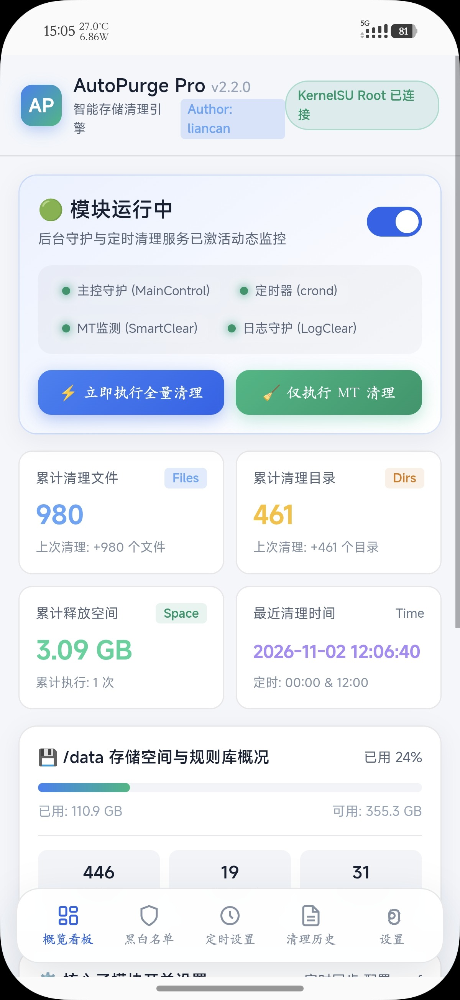
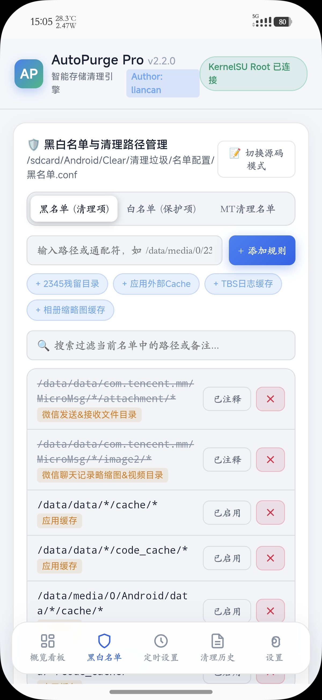
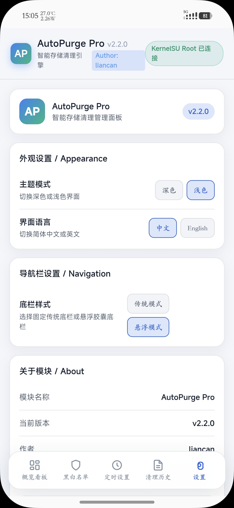
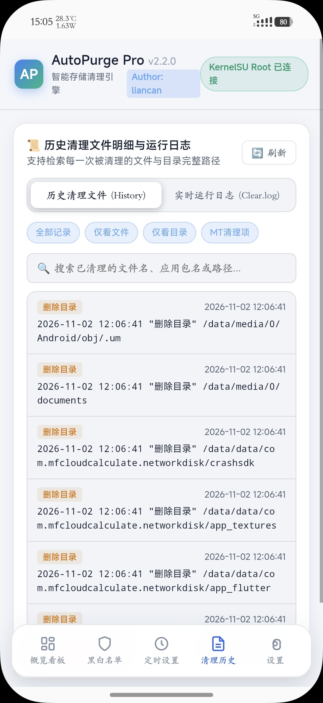
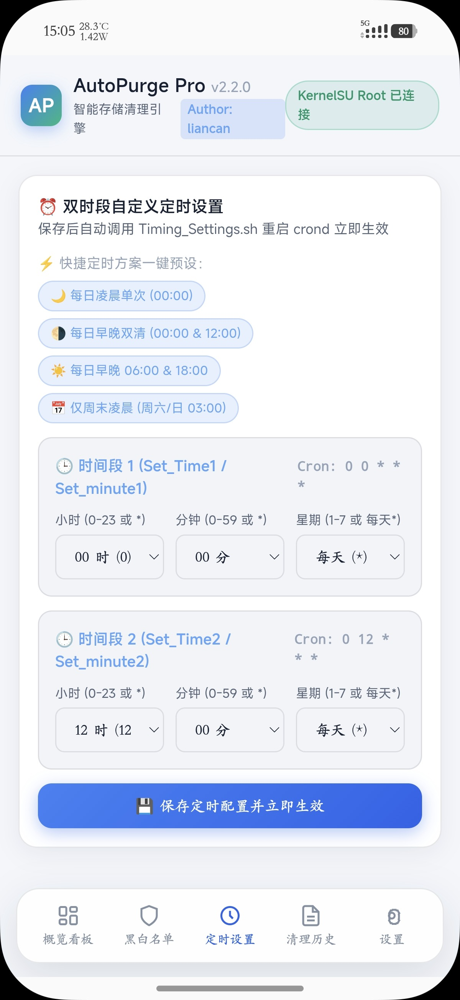

# 🧹 AutoPurge Pro

<div align="center">

### Android 智能清理模块 · WebUI 增强版

**让 Android 清理更简单，让设备管理更直观。**


[📥 下载模块](https://github.com/yunyu614/AutoPurge-Pro/releases/latest) · [📖 项目主页](https://github.com/yunyu614/AutoPurge-Pro) · [💬 问题反馈](https://github.com/yunyu614/AutoPurge-Pro/issues)

</div>

---

## 📖 一、项目简介

**AutoPurge Pro** 是一款面向 Android Root 用户的智能清理模块。

项目以自动化清理、可视化管理和灵活配置为核心，通过独立的 WebUI 管理界面，将清理规则、黑白名单、定时任务及运行记录集中管理。

不再需要频繁手动修改配置文件，通过直观的操作界面即可管理相关功能。

我们希望让 Android 设备的日常清理更加简单、高效、直观，同时给予用户更灵活的自定义管理能力。

## ✨ 二、核心功能

| 功能 | 说明 |
|---|---|
| 🖥️ WebUI 管理 | 独立可视化管理界面 |
| 🎨 主题切换 | 支持深色、浅色主题 |
| 🌐 多语言 | 支持中文、英文切换 |
| 🛡️ 黑白名单 | 自定义清理规则与保护路径 |
| 📊 数据统计 | 查看累计清理统计及释放空间 |
| 🕘 历史记录 | 追溯历史清理文件及相关记录 |
| ⏰ 定时任务 | 支持双时段定时清理配置 |
| ⚙️ 功能总开关 | 统一控制自动清理任务 |

## 🖼️ 三、WebUI 界面展示

### 1. 📊 运行总览

查看模块运行状态、清理统计及相关数据，快速了解模块运行情况。



### 2. 🛡️ 黑白名单管理

自定义清理规则与保护路径，根据个人需求调整清理范围。



### 3. 🎨 外观与界面设置

支持主题切换、中英文切换及界面相关设置，打造更符合个人习惯的操作体验。



### 4. 🕘 历史记录追溯

查看历史清理记录，追溯相关文件路径，方便了解清理执行情况。



### 5. ⏰ 定时清理配置

支持双时段定时任务配置，根据设备使用习惯安排自动清理时间。



---

## 📱 四、安装指南

### 环境要求

| 项目 | 要求 |
|---|---|
| 运行平台 | Android |
| 权限要求 | Root |
| 安装格式 | ZIP 模块 |
| 管理工具 | KernelSU / APatch 等兼容管理器 |

### 安装步骤

**① 下载模块**

前往 [GitHub Releases](https://github.com/yunyu614/AutoPurge-Pro/releases/latest) 下载最新版本 ZIP 安装包。

**② 打开 Root 管理器**

进入 KernelSU、APatch 或其他兼容的模块管理器。

**③ 选择本地安装**

找到下载的 AutoPurge Pro ZIP 文件，选择安装。

**④ 完成安装**

按照管理器提示完成安装及必要的后续操作。

**⑤ 进入 WebUI**

安装完成后，通过模块提供的 WebUI 入口进入管理界面。

---

## ⚙️ 五、配置说明

模块配置目录：

```text
/sdcard/Android/Clear/清理垃圾/
```

首次使用建议：

- 检查黑名单与白名单配置。
- 确认清理规则及目标路径。
- 根据个人习惯设置定时任务。
- 查看清理统计及历史记录。
- 确认配置无误后再启用自动清理。

## ⚠️ 六、使用须知

1. 使用前请确认设备已经获取 Root 权限。
2. 清理规则会影响文件删除范围，请谨慎配置。
3. 不建议将重要数据目录加入清理范围。
4. 修改配置后建议检查规则是否正确。
5. 重要数据请提前备份，避免误操作造成数据丢失。
6. 不同 Android 系统版本及 Root 环境可能存在兼容性差异。

---

## 🚀 七、版本更新

### v2.2.0 · WebUI 增强版

本次版本主要更新：

- 🖥️ 全新 WebUI 管理界面
- 🎨 增加深色、浅色主题切换
- 🌐 增加中英文界面切换
- 🛡️ 增强黑名单与白名单管理
- 📊 增加累计清理统计看板
- 🕘 增加历史清理文件追溯
- ⏰ 增加双时段定时清理配置
- ⚙️ 增加清理功能总开关

---

## 📥 八、下载中心

<div align="center">

### AutoPurge Pro v2.2.0

获取最新安装包及版本更新信息。

[](https://github.com/yunyu614/AutoPurge-Pro/releases/latest)

[查看全部历史版本](https://github.com/yunyu614/AutoPurge-Pro/releases)

</div>

---

## 👨‍💻 九、作者信息

**Author：liancan**

项目地址：[yunyu614/AutoPurge-Pro](https://github.com/yunyu614/AutoPurge-Pro)

如果你觉得项目对你有帮助，欢迎点亮 ⭐ Star 支持项目持续完善。


---

<div align="center">

**AutoPurge Pro · Make Android Cleaner**

*© 2026 liancan*

</div>
